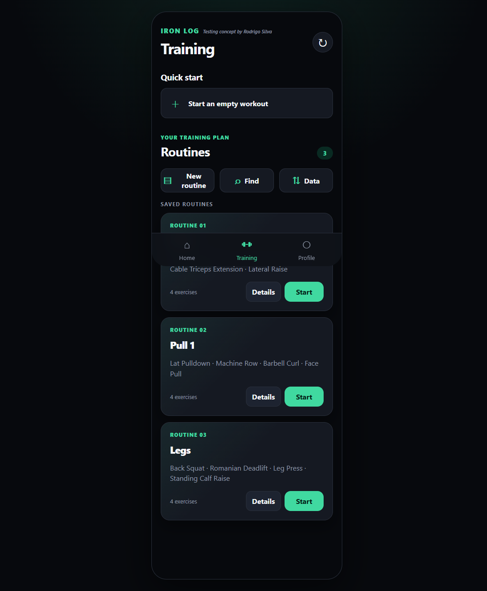
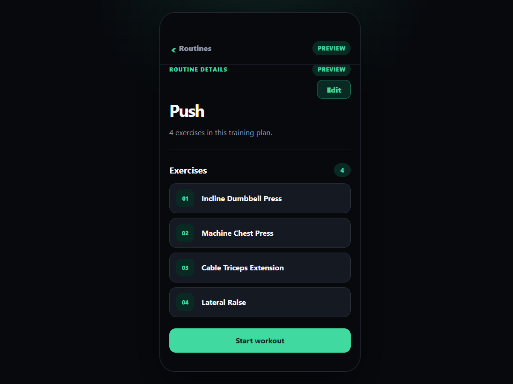
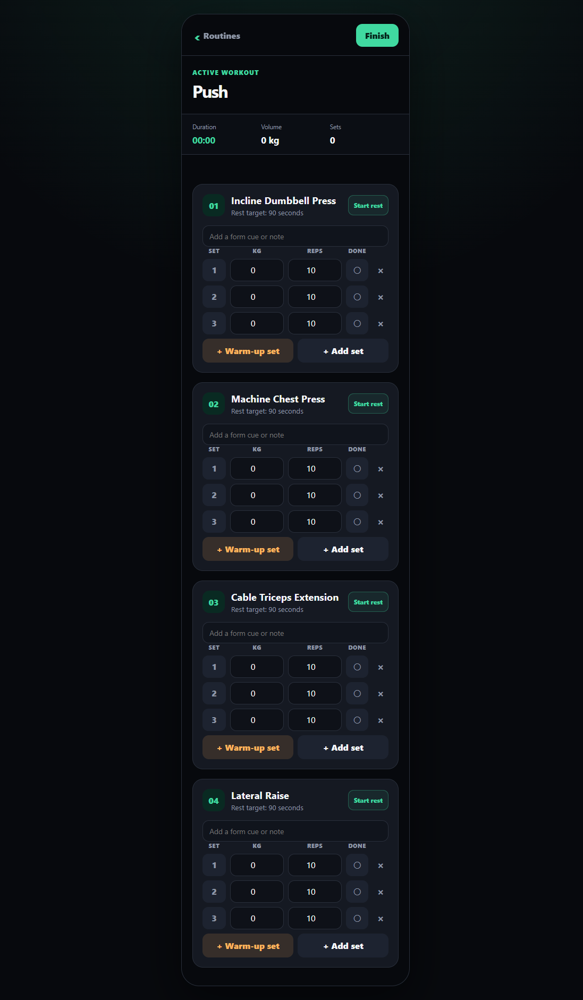

# Iron Log

**A personal workout-tracking app concept by Rodrigo Silva.**

Iron Log is a mobile-first prototype for planning gym routines and logging workouts. This repository presents the concept alongside a working implementation; it is a personal project and is not intended as a production fitness or medical service.

## Screenshots

| Training and saved routines | Routine details |
| --- | --- |
|  |  |

| Active workout |
| --- |
|  |

## Features

- Create, search, view, and edit workout routines.
- Add exercises from a built-in list or enter custom exercises.
- Configure working sets, warm-up sets, target weights and reps, rest periods, and exercise notes.
- Track a workout's elapsed time, completed sets, and working-set volume.
- Use a rest timer with optional sound and vibration alerts where supported by the browser.
- Save completed workouts and export or restore app data.
- Start an empty workout or follow a saved routine.

## Run locally

### Requirements

- Python 3.11 or newer
- A modern web browser

### Setup

From the project directory, create and activate a virtual environment, install dependencies, and start the development server:

```powershell
python -m venv .venv
.\.venv\Scripts\Activate.ps1
python -m pip install -r requirements.txt
python -m uvicorn Iron_Log:app --reload
```

Open [http://127.0.0.1:8000](http://127.0.0.1:8000) in your browser.

On Windows, if script activation is restricted, run the install and server commands using the virtual environment's interpreter directly:

```powershell
.\.venv\Scripts\python.exe -m pip install -r requirements.txt
.\.venv\Scripts\python.exe -m uvicorn Iron_Log:app --reload
```

## Technical overview

- **Backend:** Python, FastAPI, Pydantic, and Uvicorn.
- **Frontend:** HTML, CSS, and vanilla JavaScript; served by FastAPI from `static/`.
- **Browser storage:** workout and routine state is stored in IndexedDB, with a localStorage fallback. This data belongs to the current browser profile and is not synced to an account or cloud service.
- **Server storage:** the FastAPI app initializes a local SQLite database (`iron_log.db`) for its API and backup compatibility routes.
- **Backups:** the browser app can export and restore its JSON backup format. The server also provides routes for SQLite backup operations and legacy database conversion.

## Project layout

```text
Iron_Log_app/
├── Iron_Log.py       # FastAPI app and SQLite/API logic
├── requirements.txt  # Python dependencies
├── static/
│   ├── index.html    # App markup
│   ├── styles.css    # Responsive styling
│   ├── app.js        # UI and workout interactions
│   └── store.js      # Browser-side persistence and backup data
└── screenshots/      # README screenshots
```

## Data and prototype notes

Your browser-side routines and workout logs stay in that browser's storage unless you export them. Clearing browser data or switching browsers/devices can make them unavailable, so export backups if you want to keep a copy. The local SQLite database is separate from the browser's IndexedDB data.

Iron Log is an evolving app concept. The included sample routines are starter content, and the current prototype does not provide user accounts, cloud synchronization, or a hosted service.

## Publish this project to GitHub

1. Create a **new, empty** repository on GitHub. Do not initialize it with another README or `.gitignore`.
2. In a terminal, change to this project directory and run:

   ```powershell
   git init
   git add .
   git status
   git commit -m "Add Iron Log workout tracker concept"
   git branch -M main
   git remote add origin https://github.com/rreiss22/rep1.git
   git push -u origin main
   ```

3. Replace the remote URL with your GitHub repository URL. Check `git status` before committing: `.gitignore` excludes the generated SQLite database, Python cache files, and virtual environments.

Once pushed, GitHub will render this README on the repository's front page, including the screenshots.
